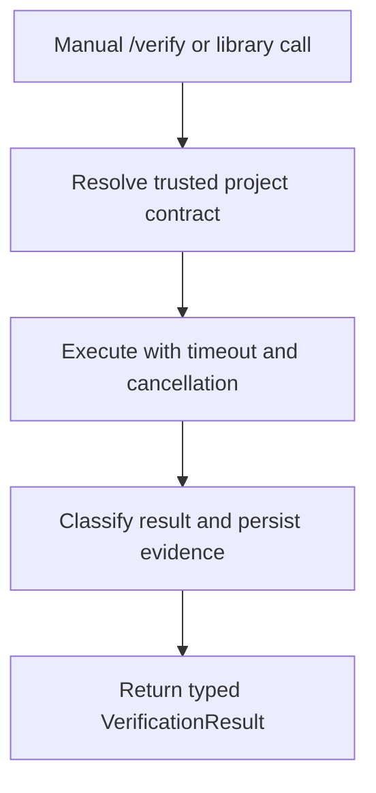
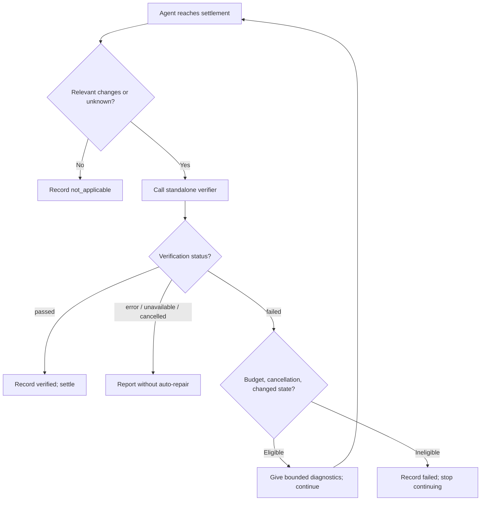

# Product Requirements Document: Pi Engineering Harness

**Status:** Proposed / ready for implementation planning  
**PRD revision:** 0.2 (revised scope; not a package release)  
**Date:** 2026-10-25  
**Product:** Reusable, versioned engineering harness package for [Pi](https://pi.dev/)  
**Primary user:** Software engineer using Pi across unrelated repositories  
**Initial target projects:** Python modular monolith; React/TypeScript SPA; Rust library with WASM bindings

## 1. Executive summary

Build a reusable, versioned Pi engineering-harness package, beginning with **a standalone verification capability** and evolving into **a bounded repair controller**. Each project supplies its own noninteractive verification script, architecture rules, and CI checks. The Pi adapter supplies developer-facing commands and, in a later release, automated lifecycle integration.

**Two separate concepts must remain explicit:** *verification* means the configured checks ran successfully; *acceptance* means the product requirements have been evaluated and approved. Passing `scripts/verify` does not establish requirement acceptance.

The proposed release sequence is:

- **v0.1 — Verification primitive:** project discovery, manual `/verify`, structured results, timeout/cancellation, evidence, contract tests, and a small Pi lifecycle feasibility spike. **Automatic repair is disabled by default and not required for v0.1.**
- **v0.2 — Repair controller:** opt-in automatic verification at settlement, diagnostics feedback, at most two repair continuations, explicit execution context, and lifecycle tests.
- **v0.3 — Composition:** callable verifier API for other extensions, optional verification levels, more sophisticated change tracking/caching, and integration with orchestrators or delegated agents.

This is **PRD 1: Project Verification and Bounded Repair**, not a comprehensive multi-agent orchestration platform. Subagent management, context retrieval, task decomposition, and acceptance evaluation are deliberately separate future products.

## 2. Problem statement

A coding agent instructed to "run tests before completing" can forget, prematurely declare success, select insufficient checks, or misrepresent what ran. Even when verification is invoked, error handling and retries differ between sessions and repositories. This produces inconsistent engineering evidence and makes it difficult to evaluate whether agent autonomy is improving.

Duplicating verification orchestration within every repository creates drift. A global extension that hardcodes `pytest`, `vitest`, and `cargo` is equally undesirable because it couples generic agent operations to concrete technology stacks.

**Problem to solve:** Provide one reusable harness that makes verification and limited self-repair an explicit agent lifecycle operation, while leaving requirements, architecture, validation commands, and CI policy with the repository.

## 3. Goals and success measures

### 3.1 Goals

- **G1 — Reusability:** One Pi package works unchanged in Python, React/TypeScript, and Rust/WASM repositories.
- **G2 — Reliable verification:** v0.1 exposes a manually callable verifier; v0.2 adds a lifecycle completion gate that independently invokes the project contract or reports it unavailable.
- **G3 — Bounded repair (v0.2):** An optional controller can return failure diagnostics and request at most two *automatic repair continuations* per execution by default.
- **G4 — Evidence:** Every attempted verification produces a structured result including command, status, duration, attempts, and diagnostic location.
- **G5 — Reproducibility:** The package is versioned and installable through Pi's native package system, with project-specific pinned versions.
- **G6 — Low coupling:** No repository is required to import Pi SDK code, and the package does not assume any build tool or language.
- **G7 — Control:** Engineers can run verification manually, inspect the outcome, cancel execution, and disable automatic repair through configuration.

### 3.2 Release acceptance thresholds

**v0.1:**
- One verifier library and Pi `/verify` command work across all three fixture repositories with their distinct scripts.
- Every invocation yields a typed status, actual exit code when available, duration, and versioned evidence; absent scripts and process failures never appear as success.
- Timeout, cancellation, truncated output, and unexpected process errors have deterministic outcomes.
- Verification is callable without starting repair or requiring a writable agent.
- Clean install and pinned package source are covered by a smoke test.

**v0.2:**
- Changed work invokes verification at the supported settlement boundary; a deliberate failed check provides diagnostics and triggers a bounded continuation.
- Two unsuccessful repair continuations exhaust the default budget; the controller stops rather than re-entering indefinitely.
- State is scoped to a distinct execution and not accidentally reset by continuation or session resumption.
- The harness clearly distinguishes verification outcome from unassessed product acceptance.

**Pilot measurement:** autonomous correction rate, invocation count, median duration, false-positive/missed gates, human interventions, and terminal outcome distribution. Do not assume productivity benefits before measuring them.

## 4. Scope

### v0.1 — In scope

1. Native versioned Pi package with a **headless verification library** and thin Pi adapter.
2. Project-owned noninteractive `scripts/verify` contract; root discovery with an explicit override.
3. Manual `/verify` command that does **not** initiate repair.
4. Typed request/result contracts, explicit execution context, and distinct verification and acceptance statuses.
5. Timeout, cancellation, bounded diagnostics, and versioned local evidence records.
6. Unit tests, three technology fixture projects, command integration tests, installation/release smoke test.
7. A separately tested Pi lifecycle spike, without enabling automatic repair by default.

### v0.2 — In scope

1. Independent **repair controller** consuming the verifier result; opt-in `agent_before_settle` integration.
2. At most two automatic repair continuations per execution by default.
3. Correct state transitions across continuations, cancellation, and session interruptions.
4. Conservative change detection (unknown means verify); detect changes after a prior successful check.
5. Lifecycle acceptance tests, other-extension composition tests, and explicit terminal reports.

### v0.3 — Possible scope, separately gated

- Stable programmatic invocation from other extensions and orchestrators.
- Fast/full/integration verification profiles.
- Improved repository state fingerprints, caching, and multi-contract discovery where justified.
- Delegated-agent interoperability and evaluation trace adapters; **not** a built-in subagent framework.

### Out of scope for all three initial releases

- General multi-agent orchestration, subagent scheduling, independent LLM reviewers.
- Task decomposition, durable workflow graphs, or knowledge-graph retrieval.
- Product acceptance/requirements judging by an LLM.
- Building language-specific linters or replacing pytest, ESLint, cargo, or CI.
- Guaranteed security isolation, credential protection, auto-merge, deployment, or release.
- Automatic harness self-improvement or edits to protected verification policy.

## 5. Users and scenarios

### Persona A — Individual developer

Uses Pi interactively in three projects. Wants one predictable command, consistent verification on completion, and visible evidence of failures and repairs without maintaining three different Pi extensions.

### Persona B — Maintainer of engineering standards

Publishes a tested version of the extension. Wants projects to pin versions and roll out upgrades incrementally, while retaining local freedom to choose verification tools.

### Persona C — Evaluator

Runs repeatable agent tasks and needs machine-readable proof of checks, retry counts, execution times, outcomes, and harness version.

### Representative journeys

**J1: Successful React task (v0.2).** Agent changes a React component and test. Before settling, the controller invokes the React repository's script. All checks succeed. The session settles; the evidence file includes `passed`, exit code `0`, and duration.

**J2: Failing Python task that self-repairs (v0.2).** Agent breaks a cross-module import rule. Project script exits nonzero. Extension presents concise diagnostics and requests continuation. Agent fixes the import. Next verification passes and evidence records both attempts.

**J3: Rust/WASM task that cannot pass (v0.2).** Agent adds a WASM dependency incompatible with the target. Checks fail, feedback is returned, and two repair continuations do not fix it. Extension stops auto-continuation and records failure, retaining diagnostics for human investigation.

**J4: Missing project contract.** User opens an unconfigured repository. Manual `/verify` explains how to add a verification script. Automatic mode must not mark the task verified.

**J5: Unchanged read-only question.** Agent only inspects files. No completion verification is required unless the user runs `/verify`; the outcome is `not_applicable` rather than `passed`.

## 6. Architecture and ownership

```text
Pi runtime
  |
  +-- Pi adapter /verify                       [v0.1]
  |      |
  |      +-- Verification service              [v0.1, reusable]
  |                +-- Project contract discovery
  |                +-- Process runner
  |                +-- Structured results & evidence
  |
  +-- Repair controller + lifecycle adapter    [v0.2, opt-in]
  |      +-- Execution identity / retry budget
  |      +-- Decision: retry, stop, escalate
  |      +-- Calls the same verification service
  |
  +-- Task orchestrators / subagents           [future, external clients]
         +-- May call verification directly

Project repository (authority)
  +-- AGENTS.md, requirements, architecture
  +-- scripts/verify, build/test tools
  +-- CI independently executes required checks
```

**Separation invariant:** Verification does not request an agent continuation or decide retry eligibility. The repair controller does not implement language-specific checks. Neither automatically declares product acceptance.

### Core contracts

```typescript
interface ExecutionContext {
  executionId: string;            // stable for one engineering task
  taskId: string;                 // may differ from Pi session ID
  parentTaskId?: string;         // for future delegation
  agentId: string;               // main agent in v0.1/v0.2
  projectRoot: string;
  worktree?: string;
  harnessVersion: string;
}

type VerificationStatus =
  | "passed" | "failed" | "error"
  | "unavailable" | "cancelled" | "not_applicable";

type AcceptanceStatus = "accepted" | "rejected" | "not_evaluated";

interface VerificationRequest {
  context: ExecutionContext;
  contractPath: string;
  trigger: "manual" | "automatic" | "external";
  level?: "full";               // v0.1: one mandatory contract only
}

interface VerificationResult {
  status: VerificationStatus;
  acceptanceStatus: AcceptanceStatus; // always not_evaluated in v0.1/v0.2
  exitCode?: number;
  durationMs: number;
  evidencePath?: string;
  diagnostics: string;
}

interface Verifier {
  verify(request: VerificationRequest): Promise<VerificationResult>;
}

interface RepairController {
  decide(result: VerificationResult, context: ExecutionContext):
    "continue" | "stop" | "escalate";
}
```

Interfaces above are **logical contracts**, not asserted Pi SDK method signatures. `ExecutionContext` is created/managed by the harness adapter and must not assume one Pi session equals one task. A caller must provide or derive a stable execution ID; resumption/restart behavior must be tested before enabling automatic repair.

### Responsibility split

| Concern | Owner |
|---|---|
| Check execution, classification, diagnostic evidence | Verification service |
| Retries, budget, settlement continuation | Repair controller (v0.2) |
| Session-to-execution identity mapping | Pi lifecycle adapter (v0.2) |
| Domain/architecture/acceptance requirements | Repository + product owner |
| Deterministic check configuration | Repository |
| Protected enforcement | CI / OS boundary |
| Publish/version and compatibility | Harness maintainers |

## 7. Project verification contract

### 7.1 Baseline contract

Each participating repository exposes a project-root-relative executable script:

```bash
./scripts/verify
```

Contract requirements:

- Noninteractive; no prompts requiring terminal input.
- Exit code `0` **only** when all configured required checks pass.
- Any nonzero exit code indicates failed verification or an execution error (classified separately by the harness where possible).
- Diagnostics go to stdout/stderr.
- Runs from the repository root with a documented environment.
- Must not implicitly deploy, publish, modify external systems, or mutate source files.
- Must have documented prerequisites (e.g., dependencies, local services, WASM target).
- It must be executable under the project's supported development environment.

The harness invokes an argument-vector process rather than constructing an interpolated shell command from arbitrary user/model text. It validates the resolved path and working directory.

### 7.2 Example project implementations

**Python modular monolith:**

```bash
#!/usr/bin/env bash
set -euo pipefail
uv run ruff check .
uv run mypy src
uv run lint-imports
uv run pytest -q
```

**React/TypeScript:**

```bash
#!/usr/bin/env bash
set -euo pipefail
npm run typecheck
npm run lint
npm run architecture
npm run test -- --run
npm run build
```

**Rust/WASM:**

```bash
#!/usr/bin/env bash
set -euo pipefail
cargo fmt --all -- --check
cargo clippy --workspace --all-targets -- -D warnings
cargo test --workspace
cargo check --target wasm32-unknown-unknown
```

These are **illustrative**: repositories choose their own commands and may need integration tests or browser tests in addition. E.g., checking Rust for a WASM target is not a substitute for a WASM runtime test.

### 7.3 Optional later extensions to contract

Consider `scripts/check` for inexpensive feedback and `scripts/verify-integration` for costly environments only after core behavior is stable. Do not require multiple commands in MVP.

## 8. Functional requirements

### FR-01 — Package discovery and loading

- The package uses Pi's native `package.json` `pi` manifest and an extension module exporting the supported `ExtensionAPI` factory.
- Installable from local path during development and pinned npm or Git sources for releases.
- No project-specific Pi source code required.

**Acceptance:** Installed via `pi -e .` for smoke tests and via Pi package installation in fixture projects.

### FR-02 — Project root discovery

- Determine verification working directory using the active Pi session's working directory and an explicit root-discovery policy.
- MVP root discovery uses the nearest ancestor containing the contract script, bounded by a configured search root; document behavior in nested repositories and worktrees.
- Avoid searching upward beyond configured trust boundaries.
- Allow explicit project root override.

**Acceptance:** Correct root selected for ordinary repo, nested source directory, and worktree; missing and ambiguous roots reported.

### FR-03 — Manual verification command

- Register `/verify` using Pi's supported command API.
- Executes the project contract without creating an autonomous repair loop.
- Shows pass/fail/unavailable and duration; provides access to diagnostic log.
- If verification is already running, refuse or join predictably (choose and document one policy; initial policy: refuse duplicate invocation).

**Acceptance:** Manual command produces the correct exit-derived result and evidence record for pass, fail, and absent script.

### FR-04 — Change detection (v0.2)

- Automatic verification is triggered for agent tasks that may have modified relevant repository files.
- Track known file-mutating tools and observed state, but do **not** rely only on tool names: shell commands and custom tools can also change files.
- v0.2 uses a conservative before/after working-tree snapshot (or equivalent state check) within the selected repository scope, supplemented by tool observations; more advanced fingerprint caching is deferred to v0.3. Ensure pre-existing dirty changes do not by themselves cause a false "new work" classification.
- Untracked files are included unless excluded by documented rules. Exclude output artifacts and harness logs to prevent self-triggering.
- If change detection fails, classify state as `unknown`, and by default run verification rather than silently skip.

**Acceptance:** Handles edit/write, shell-created files, pre-existing dirty working tree, and no-change tasks.

### FR-05 — Lifecycle verification gate (v0.2)

- Use Pi's current `agent_before_settle` event to run project verification when the task changed relevant code.
- Do not treat `agent_end` as final completion.
- Reuse a successful result only when the tracked relevant repository state has not changed since that run.
- Do not start a second verification while one is active.
- Preserve cancellation and handle interruption.

**Acceptance:** Agent cannot settle with unreported new failed verification while automatic verification is enabled. Note: Pi cannot guarantee a model will truthfully phrase its final message; the harness reports the authoritative result separately.

### FR-06 — Failure feedback and bounded repair (v0.2)

- On a failed verification, provide command, exit code, bounded excerpts of stdout/stderr, and full-log location to the agent.
- Request a continuation via Pi's supported return type for `agent_before_settle`.
- Maximum **two automatic repair continuations**, configurable; initial failing verification precedes these repairs.
- Counter is scoped to a stable `ExecutionContext.executionId`, not the Pi process or session lifetime.
- Reset on a new user task; do not accidentally reset when continuing a failed run or when a session is resumed.
- Stop when the budget is exhausted, when execution is cancelled, when state does not change after a failed repair (policy choice, default stop), or when verification is unavailable.

**Acceptance:** Failure → repair → success; failure → two repairs → terminal failure; failure → no change → no infinite loop.

### FR-07 — Terminal outcomes

Represent verification terminal state explicitly; `acceptanceStatus` remains `not_evaluated` in v0.1/v0.2:

- `passed`: verification executed and all required checks passed.
- `failed`: verification executed and checks failed after policy processing.
- `error`: harness could not execute or interpret verification.
- `unavailable`: project contract not configured.
- `cancelled`: user or session terminated execution.
- `not_applicable`: no relevant changes and no manual verification request.

**Acceptance:** Each verification execution has an explicit outcome; unknown/error/unavailable never become success. Task acceptance remains a separate decision.

### FR-08 — Structured evidence capture

- Write a structured JSON record per verification attempt plus a task summary.
- Include: schema version, harness version, Pi version if available, execution/task/session identifiers, acceptance status (`not_evaluated`), project root identifier (privacy-safe), timestamp, trigger (`manual`/`automatic`), script path, attempt number, exit code, status, duration, bounded diagnostics or log path, and change fingerprint.
- Include the number of repair continuations and the final outcome.
- Store artifacts in a configurable local location excluded from change detection; create securely with restricted permissions where supported.
- Minimize sensitive content. Redact common secrets and allow users to disable raw output persistence. Document that regex redaction is best-effort, not a guarantee.
- Never capture environment variables or provider credentials by default.

**Acceptance:** JSON conforms to versioned schema and records distinguish attempted, failed, and successful checks.

Illustrative record:

```json
{
  "schemaVersion": "1.0",
  "harnessVersion": "0.1.0",
  "executionId": "task-run-42",
  "taskId": "inventory-task-42",
  "acceptanceStatus": "not_evaluated",
  "trigger": "automatic",
  "command": "./scripts/verify",
  "attempt": 2,
  "status": "passed",
  "exitCode": 0,
  "durationMs": 12834,
  "repairContinuations": 1,
  "timestamp": "2026-10-25T09:00:00Z"
}
```

### FR-09 — Configuration

Provide documented extension options with the following logical defaults:

```json
{
  "enabled": true,
  "verifyPath": "scripts/verify",
  "automaticOnSettle": false,
  "maxRepairContinuations": 2,
  "timeoutSeconds": 300,
  "maxFeedbackCharacters": 12000,
  "recordEvidence": true,
  "persistRawOutput": false,
  "onMissingContract": "report-unavailable",
  "onChangeDetectionError": "verify"
}
```

The exact physical location and parsing mechanism for extension-specific configuration shall be chosen during design, respecting Pi's documented settings conventions. Do **not** assume Pi natively interprets these arbitrary keys. Validate config strictly and document precedence (explicit user config, repo config after trust, defaults).

### FR-10 — Timeouts, cancellation, and diagnostics

- Enforce verification timeout and terminate child process trees where supported.
- Prevent unbounded output buffering.
- Display relevant tail of logs while preserving information about truncation.
- Distinguish command failure from process spawn errors, timeout, and cancellation.
- Long-running work must not freeze streaming or leave zombie processes.

### FR-11 — Package releases and reproducibility

- Publish signed/provenance-backed immutable npm versions where feasible; support Git ref installation.
- Pin the Pi host API compatibility range and run compatibility checks for all declared supported Pi versions.
- Use SemVer for package releases; breaking config/contract/schema changes require a major version once stable.
- Document a tested upgrade and rollback path.
- Publish release notes with migrations and default-behavior changes.

### FR-12 — Independent verification

- The same `scripts/verify` must be callable from CI without Pi installed.
- A protected CI job should run it for relevant changes and report failures independently of agent output.

## 9. Core lifecycle and state machines

### v0.1: Standalone verification



This path never initiates repairs and remains callable by future orchestrators without a Pi lifecycle hook.

### v0.2: Optional bounded repair loop



### State invariants

1. Verification success never implies product acceptance.
2. No `passed` outcome without an executed, successful contract; no infinite continuation.
3. A successful result cannot validate changes introduced **after** that verification.
4. Verification never edits source files or automatically requests repairs.
5. Repair decisions are scoped to an execution ID and do not reset when Pi resumes the same task.
6. Manual `/verify` never initiates code modifications.
7. Error, unavailable, cancelled, and missing configuration are not successful completion.
8. Competing lifecycle extensions must not silently duplicate runs or continuation decisions.

## 10. Technical design constraints

### Pi-specific integration

- v0.1 requires only command registration and a reusable verifier. The `agent_before_settle` path is a separately validated technical spike, not enabled by default.

- `ExtensionAPI` factory to register command and lifecycle hooks.
- Use `agent_before_settle` for continuation decisions, not `agent_end`.
- Use Pi's declared event/result types; validate against the installed version, especially composition with other extensions.
- Manage state per task/session; clean up resources on session shutdown, cancellation, and reload.
- Do not start long-lived processes inside the extension factory.
- Surface status in the Pi UI where interactive; preserve machine-readable behavior in print/JSON modes.
- Avoid requiring a particular model provider.

### Suggested package modules

```text
pi-engineering-harness/
├── package.json
├── package-lock.json
├── tsconfig.json
├── src/
│   ├── extension.ts              # Pi adapter + /verify (v0.1)
│   ├── config.ts                 # Read, validate, merge config
│   ├── project.ts                # Root and contract discovery
│   ├── execution-context.ts      # Stable task/run identity
│   ├── change-detector.ts        # Conservative state detection (v0.2)
│   ├── process-runner.ts         # Timeout, cancellation, output limits
│   ├── verification.ts           # Execute project contract
│   ├── repair-controller.ts      # Optional retry state machine (v0.2)
│   ├── lifecycle-adapter.ts      # Optional Pi hook integration (v0.2)
│   ├── evidence.ts               # JSON schema and persistence
│   └── diagnostics.ts            # Redaction and summarization
├── schemas/
│   └── evidence.schema.json
├── fixtures/
│   ├── python-monolith/
│   ├── react-app/
│   └── rust-wasm/
├── tests/
│   ├── unit/
│   └── integration/
├── docs/
│   ├── installation.md
│   ├── configuration.md
│   ├── verification-contract.md
│   ├── security.md
│   └── troubleshooting.md
└── .github/workflows/
    └── release.yml
```

### Example package manifest (design target)

```json
{
  "name": "@example/pi-engineering-harness",
  "version": "0.1.0",
  "type": "module",
  "keywords": ["pi-package"],
  "files": ["src", "schemas", "docs"],
  "pi": { "extensions": ["./src/extension.ts"] },
  "peerDependencies": {
    "@earendil-works/pi-coding-agent": "*"
  }
}
```

The `@example` scope is a placeholder. Pin compatible development tooling in the package lockfile. Pi provides the host SDK; do not ship duplicate host SDK runtime copies.

## 11. Security and trust model

**Trust boundary:** Pi extensions run inside the Pi process with the user's operating-system privileges. This package is an engineering reliability control, **not** a sandbox or a hard security boundary.

Requirements:

- Only trusted users/projects can activate project-supplied verification scripts.
- Never execute a contract sourced from untrusted repository content merely because the agent discovered it.
- Do not interpolate agent-controlled text into shell command strings.
- Respect timeouts, cancellation, and output-size limits.
- Do not automatically run scripts requiring production credentials or network access.
- Do not log API keys, tokens, raw environment variables, or unredacted confidential data by default.
- Treat verification output as untrusted text. Feedback to the model is diagnostic data, not higher-priority instructions.
- CI must independently rerun authoritative checks and protect its own workflows and configuration from agent modification.
- Document interactions with third-party Pi extensions and lifecycle handler ordering.
- Automated self-repair may modify source code, but cannot be relied on to preserve protected files without external OS or CI enforcement.

## 12. Reliability and performance requirements

- **Deterministic outcomes:** Given an identical repository snapshot and verification command result, the state machine produces the same decision.
- **Bounded time:** Default five-minute timeout per check (configurable), two automatic repairs (configurable).
- **Bounded memory:** Stream output and cap in-memory diagnostics.
- **No duplicate runs:** One verification process per active task and project by default.
- **Crash tolerance:** Partial attempts are recorded as interrupted/error on recovery if reconstructable; never fabricated as passed.
- **Non-interference:** Do not alter files in the working repository except explicitly configurable, ignored evidence artifacts; prefer writing outside the working tree.
- **Compatibility:** Support versions of Pi explicitly covered by CI; do not claim a blanket compatibility guarantee.

## 13. Acceptance test matrix

| ID | Scenario | Expected result |
|---|---|---|
| AT-01 | `/verify` with passing script | Success status, exit code 0, evidence written |
| AT-02 | `/verify` with failing script | Failure shown, no automatic repair |
| AT-03 | Edit followed by completion and passing check | Check runs before settlement, status passed |
| AT-04 | First check fails, agent fixes, second passes | One continuation; final passed |
| AT-05 | Checks fail after two continuations | No further continuation; final failed |
| AT-06 | Script missing | Explicit unavailable; instructions to configure |
| AT-07 | Script cannot spawn | Error, not failed/passed |
| AT-08 | Read-only task | No automatic check; not_applicable |
| AT-09 | Agent creates file via shell | Change detected; verification runs |
| AT-10 | Existing dirty worktree, no new change | No false-positive new-change gate |
| AT-11 | Agent modifies files after a prior success | Previous success invalidated; rerun required |
| AT-12 | Verification times out | Process terminated; error or timeout status |
| AT-13 | User interrupts verification | Cancelled; no unexpected continuation |
| AT-14 | Output exceeds cap | Truncated feedback, complete bounded log strategy |
| AT-15 | Secret-looking value in output | Redacted in persisted diagnostics where covered; caveats documented |
| AT-16 | Run in Python, React, and Rust fixtures | Same extension, independent project scripts |
| AT-17 | Install pinned version in clean Pi environment | Resources load and command available |
| AT-18 | Pi runtime upgrade outside supported range | Compatibility failure is detectable and documented |
| AT-19 | Concurrent/manual verification while active | Deterministic duplicate-run policy |
| AT-20 | Two consecutive different user tasks | Repair count resets for new task only |

## 14. Delivery milestones and release gates

### M0 — Technical spike (prerequisite, not release)

Confirm installed Pi lifecycle signatures, tool/command APIs, session identity and composition with other extensions. Demonstrate one controlled continuation in a fixture. **Exit:** documented, tested SDK assumptions; no production repair behavior enabled.

### M1 — v0.1: Standalone verifier + manual command

Implement trusted project discovery, typed request/result, context identity, `scripts/verify` execution, timeout/cancellation, bounded output, `/verify`, basic JSON evidence and package release tests. Use Python, React, Rust fixtures. **Exit:** all three fixtures pass identical verifier conformance tests; automatic verification/repair is off.

### M2 — v0.2: Optional lifecycle verification

Add conservative change detection, `agent_before_settle` adapter, re-verification on further edits, and explicit failure reporting. Keep controller separate from verifier. **Exit:** changed/unknown state checked, no-change behavior correct, conflicts with other hooks tested.

### M3 — v0.2: Bounded repair controller

Add controlled feedback continuation, two-repair budget, stable execution-scoped state, no-change stop, interruption handling, and explicit terminal outcomes. **Exit:** one-repair success, exhausted budget, resume, cancellation, and missing-contract tests pass.

### M4 — v0.3: Composability and optional profiles

Expose documented programmatic verifier integration, optional verification levels, improved fingerprint/caching only if justified by measured cost, and compatibility tests with delegated agents/orchestrators. **Exit:** an independent extension can request verification without invoking the repair controller.

### M5 — Pilot and evaluation

Pin and trial a released package in the three real repositories, keep CI authoritative, run standardized harness behavioral scenarios, and measure autonomous corrections, gate misses, and review overhead. **Exit:** recorded results and independent upgrade/rollback demonstrated.

## 15. Prioritized backlog

| Priority | Release | Story |
|---|---|---|
| P0 | v0.1 | Install and invoke the package from Pi |
| P0 | v0.1 | Execute a trusted project-owned `scripts/verify` |
| P0 | v0.1 | Manual `/verify` displays typed status and diagnostics |
| P0 | v0.1 | Verification callable independently of repair |
| P0 | v0.1 | Distinguish verification from product acceptance |
| P0 | v0.1 | Timeouts, cancellation, and versioned evidence work |
| P0 | v0.1 | All three language fixtures pass the contract suite |
| P0 | v0.2 | Agent settlement triggers checks when code changes |
| P0 | v0.2 | Repair controller enforces maximum two continuations |
| P0 | v0.2 | Execution state survives continuation and does not confuse session with task |
| P1 | v0.2 | Unchanged state skips checks; new changes invalidate prior success |
| P1 | v0.2 | Another extension's lifecycle hooks do not corrupt state |
| P1 | v0.3 | External extensions invoke verifier via supported integration |
| P2 | v0.3+ | Verification profiles, tracing exports, cross-agent evaluation |

## 16. Open decisions before coding

1. **Execution identity:** How will a stable harness execution ID map to Pi session/run IDs across resumed sessions and message-triggered continuations? Do not equate task to session.
2. **Change detection (v0.2):** What conservative repo-state check covers shell edits, untracked files, and pre-existing dirty trees? Defer sophisticated caching to v0.3.
3. **Configuration location:** Choose project/global override format and parsing with clear precedence. Do not embed unspecified keys into Pi settings and assume they are supported automatically.
4. **Failure policy:** Should missing verification block completion or simply produce a visible `unavailable` state? MVP decision: do not auto-repair, never report success, show explicit status; CI remains authoritative.
5. **Console UX:** How much context should the extension display in TUI versus headless JSON mode?
6. **Evidence privacy:** Default external user data retention and export rules for enterprise adoption.
7. **Monorepos:** How should nested subprojects and multiple scripts be selected? MVP supports one contract per selected working project; multi-contract discovery is deferred.
8. **Composable extensions:** How does this package behave when another extension also requests continuation in `agent_before_settle`? Write integration tests based on declared ordering semantics.

## 17. Definitions of done

### v0.1 — Verification primitive

- [ ] Package installs from a local path and pinned source.
- [ ] `/verify` works in interactive and noninteractive Pi modes.
- [ ] Verifier library can be invoked independently of a repair controller.
- [ ] Structured `ExecutionContext` and typed `VerificationResult` are implemented.
- [ ] Verification reports `acceptanceStatus: not_evaluated` and does not conflate checks with requirements acceptance.
- [ ] Missing contract, process errors, timeout, and cancellation are explicit statuses.
- [ ] Evidence conforms to a versioned JSON schema; sensitive output minimized.
- [ ] The core code is unaware of Python, React, and Rust tools.
- [ ] Three language fixture repositories and clean-install smoke tests pass.
- [ ] CI independently executes project verification; security/trust limitations documented.
- [ ] Lifecycle feasibility spike results and supported Pi API version are documented.
- [ ] No autonomous repair is enabled by default.

### v0.2 — Repair controller

- [ ] Changed work triggers external verification before settling when enabled.
- [ ] Failure diagnostics can request a maximum of two automatic continuations.
- [ ] Controller and verifier have separate implementations and tests.
- [ ] Execution-scoped state survives continuation/resumption without resetting the budget.
- [ ] No-change, changed-after-pass, interrupted, missing-contract and conflicting-hook scenarios pass.
- [ ] Exhausted or nonretryable outcomes are explicit; no false acceptance is recorded.

### v0.3 — Composable verification

- [ ] Separate orchestrator/extension can invoke verification without any repair loop.
- [ ] Optional verification levels and state caching are specified and tested where adopted.
- [ ] Harness evaluations track regressions across supported Pi versions and repositories.

## 18. References

- [Pi — Extensions](https://pi.dev/docs/latest/extensions) — lifecycle events, `agent_before_settle`, commands, session state and event composition.
- [Pi — Packages](https://pi.dev/docs/latest/packages) — package manifests, npm/Git distribution, local installs, host-provided dependencies.
- [Pi — Overview](https://pi.dev/) — product model, extension points, supported execution modes.

**Implementation note:** Consult the exact exported Pi TypeScript declaration files for event payloads and return types at the Pi version pinned for development. This PRD specifies behavior, not a guessed implementation of undocumented APIs.
